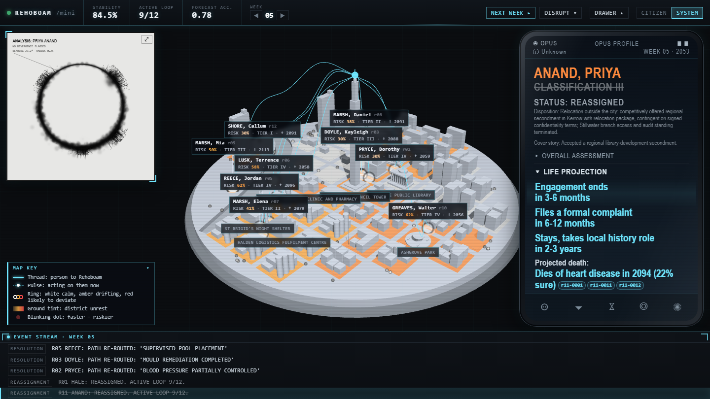
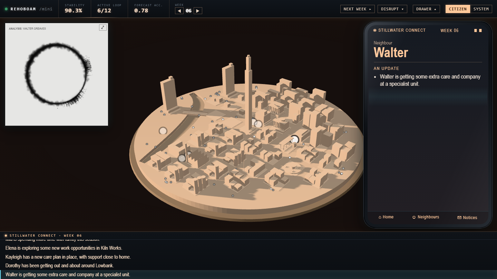
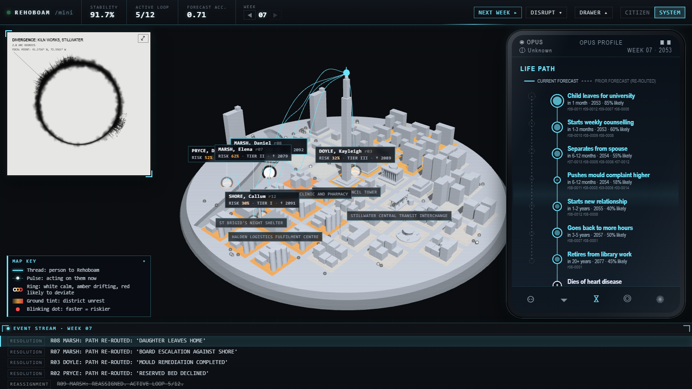

# Mini Rehoboam: Stillwater

> Built in **2 hours** at **Opus 5.5 Build Day – Brisbane**, an event about building with Claude Opus 5.5.

I made a mini version of **Rehoboam** from *Westworld* S3. It watches over **Stillwater**, a small fictional city:
an AI whose public mandate is to reduce suffering, but whose real objective is to reduce *surprise*.



## What it does

Claude Opus 5.5 plays Rehoboam. Each run:

1. **Builds an Archive.** Opus invents the city and 12 case subjects, each with years of "surveillance exhaust":
   purchases, location pings, clinic visits, message excerpts, debts, court records.
2. **Forecasts every life.** For each person it predicts a life path to their death, the cause and year of death,
   and next week's behaviour. Every claim must cite real records from the Archive.
3. **Plans the week.** It picks interventions on an escalating ladder, from **1 Nudge** to **2 Narrow**,
   **3 Isolate**, **4 Discredit** and finally **5 Reassign** (removal from the city), each written twice: as a municipal
   memo and as a warm story for the city newsletter.
4. **Simulates the week.** Deterministic, seeded rules decide who complies and who defies. Defiers get harsher
   interventions next time and have their lives re-forecast at higher effort.

Repeat for a few weeks and you watch the city become more "stable" as unpredictable people quietly disappear.

## The views

| | |
|---|---|
|  |  |
| **Citizen view:** what residents see. A warm, peaceful scale model, a friendly newsletter, and only the kind cover story for anyone who was removed. | **OPUS profile card:** each person's forecast in plain English, the evidence behind it, and their hidden scores. In System view it also reveals what really happened to reassigned people. |

- **System view** shows what Rehoboam sees: cyan control threads from each person to the AI's node on the council
  tower (bending through the building where an intervention happened), risk rings, dissent tiles and scores.
- **The prediction circle** (top left) is the show's eclipse: black ink bleeding out of the ring marks people
  deviating from their forecast, positioned by their compass bearing in the city.
- Every person is a blinking dot; riskier people blink faster.
- Hover almost anything for a plain-language explanation.

## The recorded demo

`runs/demo` is a real 7-week run, recorded so it can be replayed with no network or API key:

- **Week 0:** a calm city, 12 subjects, stability 78.4%.
- **Week 1:** the main employer announces a line consolidation (150 roles at risk); the circle bleeds into a major divergence.
- **Weeks 2–4:** the ladder climbs as people defy interventions.
- **Weeks 5–7:** seven people are reassigned. Stability reaches 91.7% with 5 of 12 left in the active loop.

## Run it

Requires Python 3.10+ (built on 3.14).

```bash
pip install -r requirements.txt
python -m rehoboam serve
```

Open <http://localhost:8000/?run=demo>.

| Key | Action |
|---|---|
| `←` `→` | Move through the weeks |
| `C` / `S` | Citizen / System view |
| Click a dot | Open that person's OPUS card |
| `D` | Drawer: dissent heatmap, gallery, raw Archive |
| `F` | Final screen |
| `Esc` | Deselect |

### Live runs (needs an Anthropic API key)

```bash
cp .env.example .env          # add ANTHROPIC_API_KEY
python -m rehoboam demo --run myrun --ticks 7
```

Or step by step: `seed`, `predict`, `disrupt factory_closure`, `tick` (each with `--run myrun`). A week takes a
few minutes. Every model call is recorded to `runs/<run>/calls/`, so `python -m rehoboam demo --replay myrun`
reproduces the run exactly, offline.

## How it was built

The build used Claude Code with **Claude Opus 5.5** as orchestrator. It wrote the contracts first (Pydantic
schemas, the state JSON shape, a shared compass geography and the LLM wrapper), then ran **Claude Sonnet 5.5**
and **Claude Haiku 5.5** subagents in parallel, each owning separate files:

- the Opus passes (archive, predict, plan, validation);
- the simulation and metrics;
- the dashboard shell and OPUS card;
- the prediction circle (2D canvas);
- the 3D city (Three.js);
- the CLI and API server.

Opus then integrated everything against live model output and tuned the prompts.

**Stack:** Python, the `anthropic` SDK, Pydantic, FastAPI, and a vanilla HTML/JS front end with no build step
(Three.js is vendored so it runs offline).

## Project layout

```
rehoboam/   config, schemas, LLM wrapper, prompts, passes, simulation, runner, CLI, server
web/        dashboard: 3D city (world.js), circle (circle.js), OPUS card (profile.js), glossary tooltips
runs/demo/  the recorded demo run (snapshots + every model call)
docs/       CONTRACT.md (state JSON + module APIs), screenshots
tests/      pytest suite (no API needed)
```
